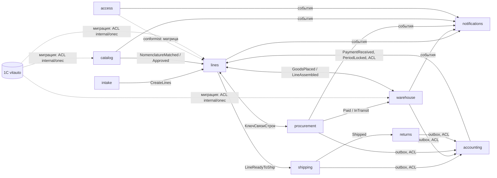

# 1. Стратегическое проектирование

## 1.1 Предметная область

Витавто продаёт и закупает запчасти под заявки клиентов. Заказы отгружаются клиентам или транспортным компаниям, а в ремонтной зоне запчасти ставятся на машины по заказ-нарядам.

Ядро — **строка АРМ** (`Line`): одна позиция заявки клиента с полным жизненным циклом:
1. заявка, подбор номенклатуры, резерв или закупка;
2. оплата, путь, приёмка, размещение;
3. комплектация, отгрузка, контроль документов, закрытие.

Строка продажи и строки закупки связаны ключом `КлючСвязиСтрок`. Кто и что видит или меняет в строке, задаёт **матрица** роль × колонка × статус.

| Поддомен | Тип | Почему |
|---|---|---|
| Строки АРМ, закупка, склад, отгрузка, возвраты, приём заявок | **core** | здесь отличие Витавто: связка продажа ↔ закупка, матрица прав по статусам, складские зоны |
| НСИ, ремонтная зона | supporting | нужны ядру, но не уникальны |
| Уведомления, доступ, интеграция с бухгалтерией | generic | типовые решения (outbox, RBAC, push) |

## 1.2 Ограниченные контексты

Полный список с агрегатами — в [generated/glossary.md](generated/glossary.md#ограниченные-контексты). Источник — `node-map.json`.

| Контекст | Модуль Go | Схема БД | Узлы процесса |
|---|---|---|---|
| `intake`, приём заявок | `internal/intake`, `internal/imp` | `imp`, `doc.customer_order` | N1, M1 |
| `catalog`, НСИ | `internal/catalog` | `ref` | M2, M2a, A1, A2 |
| `lines`, строки АРМ (ядро) | `internal/arm` | `arm.line` | M3, M9, M10 |
| `procurement`, закупка | `internal/procurement` | `doc.supplier_order` | N4, M4, M7, P1, P2, A3 |
| `warehouse`, склад | `internal/stock` | `stock`, `ref.warehouse`, `ref.storage_cell`, `doc.receipt`, `doc.transfer` | K1, K2, K3, K8, A5 |
| `shipping`, отгрузка и документы | `internal/shipping`, `internal/print` | `doc.shipment` | N2a, M12, M15, M19, K5, K7, G7 |
| `returns`, возвраты | `internal/returns` | `doc.return` | N3, M16, P3, K6 |
| `workshop`, ремонтная зона | `internal/workshop` (этап 12) | `doc.work_order` | G1–G5, G9 |
| `notifications` | `internal/notify`, `internal/realtime` | `arm.notice`, `sys.change_log` | M8, M11, M17, M18, K9, G8 |
| `access`, роли и матрица | `internal/access` | `auth`, `arm.matrix_*` | M13, A0 |
| `accounting`, бухгалтерия | `internal/integration` | `integration` | — (политики на события) |

**Правило границ.**
- Контекст меняет только свои таблицы.
- Чужие данные он читает через запросы чужого модуля или реагирует на доменные события.
- Внешние ключи между схемами допустимы, это одна база. Но запись в чужую таблицу идёт только через команду владельца.

## 1.3 Карта контекстов

Виды отношений: см. `node-map.json → contextMap`.
- **Anti-corruption layer (ACL).** Используется дважды: мигратор (`internal/onec`: перевод GUID, перечислений и составных типов) и коннектор бухгалтерии (`internal/integration`). Понятия 1С (`СтруктурнаяЕдиница`, `Регистратор`, `_IDRRef`) не проходят в доменную модель.
- **Published language.** Это REST API (OpenAPI 3.1) и события WebSocket (AsyncAPI 3.0). PWA и коннектор бухгалтерии видят только их.

## 1.4 Что остаётся за границей

| Вне системы | Где | Как связано |
|---|---|---|
| Касса и ККТ, регламентированный учёт, отчётность | 1С (вариант A плана) | контекст `accounting`, outbox |
| Клиент (N1, N2a, N3, N4) и поставщик (P1–P3) | внешние участники | их действия фиксирует менеджер или кладовщик; порталы — этап 12 |
| Ремонтная зона (G1–G9) | в 1С не реализовано | контекст `workshop`, этап 12 |
