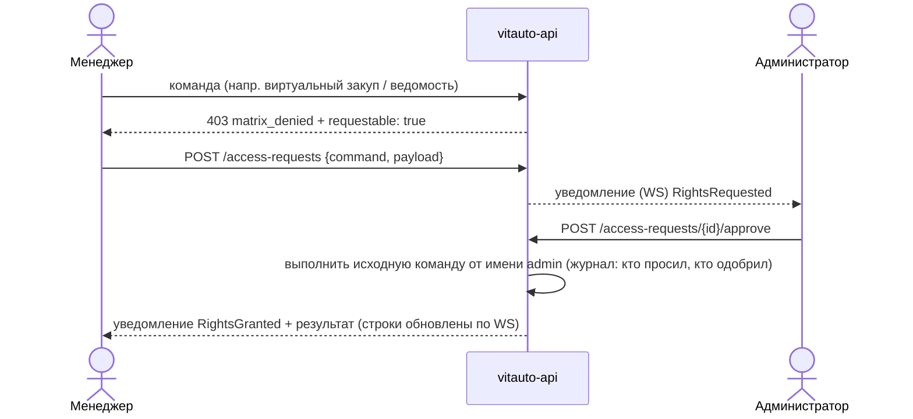

# 3. Схемы взаимодействия по матрице и ролям

Сгенерированные схемы по каждому сценарию process.html лежат в [generated/processes.md](generated/processes.md): mermaid sequence и таблица шагов, где для каждого шага указано, что роль может менять по матрице. Здесь описан общий механизм, который эти схемы исполняет.

## 3.1 Путь любого действия пользователя

```mermaid
sequenceDiagram
  autonumber
  actor u as Пользователь (роль R)
  participant pwa as PWA (Vue 3)
  participant api as vitauto-api
  participant agg as Агрегат (Line …)
  participant db as PostgreSQL
  participant hub as WS-хаб
  actor o as Другие пользователи
  u->>pwa: действие (правка поля, переход, печать)
  pwa->>pwa: denyReason(колонка, строка) — подсказка по матрице, кнопка неактивна
  pwa->>api: REST /api/v1/... (Bearer, If-Match: version)
  api->>api: сессия → Actor{role, user, warehouses}
  api->>agg: команда
  agg->>agg: authorize: версия → фон → closed → матрица → автомат статусов → склад
  alt отказ
    agg-->>api: 403 matrix_denied / 409 conflict / 409 transition
    api-->>pwa: problem+json {code, message, current}
    pwa-->>u: причина; при 403 — «Запросить у администратора» (M13)
  else разрешено
    agg->>db: изменение + sys.change_log + outbox (одна транзакция)
    db-->>hub: NOTIFY vitauto_changes (после COMMIT)
    api-->>pwa: 200 {строка, version}
    hub-->>o: change {entity, ids, fields, by} — только тем, кому видно по роли и складу
    o->>api: GET перечитать (при необходимости)
  end
```

## 3.2 Решение «можно ли» — одна функция для всех входов

Через `authorize` (02-tactical.md, 2.1) проходят все входы:
- REST от PWA;
- импорт (раздел 12 плана);
- политики;
- команды администратора по одобренному запросу.

| Проверка | Источник правила | Ответ |
|---|---|---|
| Колонка видна роли | `roleProfiles` (index.html) + маска ≠ всё `.` | поле не отдаётся в API (не только скрывается в UI) |
| Колонку можно менять | маска `arm.matrix_column`: символ статуса `+` / `c` (автор) | 403 `matrix_denied` |
| Переход статуса | автомат статусов [generated/fsm.md](generated/fsm.md) по роли | 409 `transition_denied` / 403 |
| Строка закрыта | только `admin`, кроме «Документ подписан оригинал» | 403 |
| Склад | `auth.user_warehouse` | 403 `warehouse_denied`; события по чужим складам не приходят |
| Версия | `If-Match` | 409 `conflict` + текущая строка |
| Закрытый период | `integration.period_lock` | 409 `period_locked` |

## 3.3 Роли: кто что делает

Подробно по каждой роли — в [generated/roles-matrix.md](generated/roles-matrix.md): узлы, переходы, профиль видимости групп колонок, маска каждой колонки.

| Роль | Дорожка (узлы) | Типичные команды | Получает уведомления |
|---|---|---|---|
| `manager` | M1–M19 | импорт заявки, подбор, резерв, заказ поставщику, задание на комплектацию, отклонение, ведомость, контроль документов | M8, M11, M17, M18, ответы администратора |
| `storekeeper` | K1–K9 | приёмка по УПД, размещение в ячейку, комплектация и сборочный лист, отгрузка, возврат на склад, розыск | M9, M10, K9 |
| `supply` | — (канбан) | статусы снабжения: оплачено, в пути, приходуется, на складе | общие с кладовщиком |
| `chief_mechanic` | G1–G9 | заказ-наряд, выдача в ремонтную зону, закрытие | G8 |
| `admin` | A0–A5 | НСИ, подтверждение номенклатуры, одобрение запросов прав (A3), матрица и роли | M13 (запросы), ошибки обмена |
| `supplier` | P1–P3 | (портал, этап 12) подтверждение, отгрузка, приём возврата | — |
| `client` | N1–N4 | внешние действия, фиксирует менеджер | — |

## 3.4 Параллельные шаги (∥)

Шаги вида `M15 ∥ K7`, `M17 ∥ K9`, `M18 ∥ G8` и `G4 ∥ G5` на схеме — это не передача из рук в руки. Обе роли видят одно и то же одновременно.

В модели это так:
- одно событие и одна политика порождают уведомления обеим ролям;
- любая из ролей может выполнить команду, и вторая сразу видит результат по WebSocket;
- повторная команда второй роли идемпотентна: строка уже в целевом состоянии, ответ 200 без изменений.

## 3.5 Запрос прав (M13 → A3)



## 3.6 Интеграция с бухгалтерией в схеме

Отгрузка (K5), приёмка (K1/K2), возврат (K6/P3) и перемещение одной транзакцией пишут `integration.outbox`. Воркер отправляет их в 1С (вариант A) с `Ref_Key` = UUID документа.

Обратный поток работает так:
- `PaymentReceived` переводит строки в `paid` (узел M7, источник — бухгалтерия);
- `PeriodLocked` запрещает правки закрытого периода.

Пользователи видят результат обмена так же, по WebSocket.
