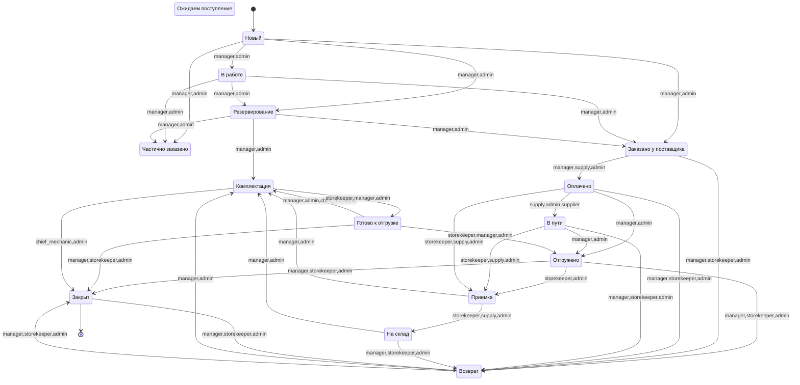

<!-- Сгенерировано tools/migration/ddd-gen.mjs из domain-model.json, node-map.json. Не править вручную. -->

# Автомат статусов строки

Переходы из кода PWA (`backend.js` TRANSITIONS = `Арм_API.ПереходыПроцессов`) и дополнения из `node-map.json` (задания, канбан снабжения, отгрузка, самовывоз). Go-реализация обязана разрешать ровно эти переходы.

| Из | В | Роли | Действующее лицо | Как | Узлы | Источник |
|---|---|---|---|---|---|---|
| new, in_work | reserve | manager, admin |  | POST /lines/transition {to: reserve} → Резервирование | M3 | код PWA (backend.js TRANSITIONS) |
| reserve, to_stock, acceptance | assembly | manager, admin |  | POST /lines/transition {to: assembly} → Комплектуется | M9, G3 | код PWA (backend.js TRANSITIONS) |
| ready_to_ship | assembly | manager, admin, chief_mechanic |  | POST /lines/transition {to: assembly} → Комплектуется | M9, G3 | код PWA (backend.js TRANSITIONS) |
| return | assembly | manager, admin |  | POST /lines/transition {to: assembly} → Комплектуется | M9, G3 | код PWA (backend.js TRANSITIONS) |
| assembly | ready_to_ship | storekeeper, manager, admin |  | POST /lines/transition {to: ready_to_ship} → Собран | K3 | код PWA (backend.js TRANSITIONS) |
| paid, in_transit | shipped | manager, admin |  | POST /lines/transition {to: shipped} → Отгружено | N4 | код PWA (backend.js TRANSITIONS) |
| shipped | acceptance | storekeeper, admin |  | POST /lines/transition {to: acceptance} → Приходуется | K1 | код PWA (backend.js TRANSITIONS) |
| shipped, ordered, paid, in_transit, to_stock, closed | return | manager, storekeeper, admin |  | POST /lines/transition {to: return} → Возврат | N3, M16, K6 | код PWA (backend.js TRANSITIONS) |
| shipped, ready_to_ship, return | closed | manager, storekeeper, admin |  | POST /lines/transition {to: closed} → Выполнено | M15, K7, G9 | код PWA (backend.js TRANSITIONS) |
| assembly | closed | chief_mechanic, admin |  | POST /lines/transition {to: closed} → Выполнено | M15, K7, G9 | код PWA (backend.js TRANSITIONS) |
| new, in_work, reserve | ordered / partially_ordered | manager, admin |  | POST /sales/jobs («В работе»: разделение строк, автозакупки) → заказ поставщику | M4 | node-map.json fsmAdditions |
| ordered | paid | manager, supply, admin |  | POST /supply/status {status: paid}; из бухгалтерии — PaymentReceived | M7, A3 | node-map.json fsmAdditions |
| paid | in_transit | supply, admin, supplier |  | POST /supply/status {status: in_transit}; поставщик — портал (этап 12) | P2 | node-map.json fsmAdditions |
| in_transit, paid | acceptance | storekeeper, supply, admin |  | POST /supply/status {status: acceptance} / POST /lines/transition {to: acceptance} | K1 | node-map.json fsmAdditions |
| acceptance | to_stock | storekeeper, supply, admin |  | POST /stock/placements (размещение в ячейку, раздел 13) / POST /supply/status {status: to_stock} | K2 | node-map.json fsmAdditions |
| ready_to_ship | shipped | storekeeper, manager, admin |  | POST /sales/shipments (дата и номер отгрузки) | K5 | node-map.json fsmAdditions |
| paid, in_transit | shipped | manager, admin | client | POST /lines/transition {to: shipped} — самовывоз фиксирует менеджер | N4 | node-map.json fsmAdditions |
| shipped | return | manager, storekeeper, admin | client | POST /lines/transition {to: return} — возврат клиента фиксирует менеджер / кладовщик | N3 | node-map.json fsmAdditions |
| new | in_work | manager, admin |  | POST /sales/jobs («В работе») | M2 | node-map.json fsmAdditions |

## Расхождения схемы и кода (решить до этапа 4)

- ordered → paid: по схеме оплату контролирует менеджер (M7), в коде PWA /supply/status разрешён только supply и admin — в Go разрешается manager, решение подтвердить у заказчика.

## Покрытие переходов сценариями process.html

| Сценарий | Из | В | Узел | Роль | Покрыт |
|---|---|---|---|---|---|
| happy | new | ordered | M4 | manager | да |
| happy | ordered | paid | M7 | manager | да |
| happy | paid | in_transit | P2 | supplier | да |
| happy | in_transit | acceptance | K1 | storekeeper | да |
| happy | acceptance | assembly | M9 | manager | да |
| happy | assembly | ready_to_ship | M11 | manager | да |
| happy | ready_to_ship | shipped | K5 | storekeeper | да |
| happy | shipped | closed | M15 ∥ K7 | manager | да |
| stock | new | reserve | M3 | manager | да |
| stock | reserve | assembly | M9 | manager | да |
| stock | assembly | ready_to_ship | M11 | manager | да |
| stock | ready_to_ship | shipped | K5 | storekeeper | да |
| stock | shipped | closed | M15 ∥ K7 | manager | да |
| mixed_order | new | reserve | M3 | manager | да |
| mixed_order | reserve | ordered | M4 | manager | да |
| mixed_order | ordered | paid | M7 | manager | да |
| mixed_order | paid | in_transit | P2 | supplier | да |
| mixed_order | in_transit | acceptance | K1 | storekeeper | да |
| mixed_order | acceptance | assembly | M9 | manager | да |
| mixed_order | assembly | ready_to_ship | M11 | manager | да |
| mixed_order | ready_to_ship | shipped | K5 | storekeeper | да |
| mixed_order | shipped | closed | M15 ∥ K7 | manager | да |
| delivery_split | new | ordered | M4 | manager | да |
| delivery_split | ordered | paid | M7 | manager | да |
| delivery_split | paid | shipped | N4 | client | да |
| delivery_split | shipped | acceptance | K1 | storekeeper | да |
| delivery_split | acceptance | assembly | M9 | manager | да |
| delivery_split | assembly | ready_to_ship | M11 | manager | да |
| delivery_split | ready_to_ship | closed | M15 ∥ K7 | manager | да |
| virtual_buy | new | ordered | M13 | manager | да |
| virtual_buy | ordered | paid | A3 | admin | да |
| defect | assembly | ready_to_ship | M11 | manager | да |
| defect | ready_to_ship | shipped | K5 | storekeeper | да |
| defect | shipped | closed | M15 ∥ K7 | manager | да |
| cancel_supplier | new | ordered | M4 | manager | да |
| cancel_supplier | ordered | paid | M7 | manager | да |
| cancel_supplier | paid | return | M15 | manager | да |
| return_mgr | return | closed | M15 ∥ K7 | manager | да |
| return_internal | shipped | return | N3 | client | да |
| return_internal | return | assembly | M10 | manager | да |
| return_internal | assembly | ready_to_ship | M11 | manager | да |
| return_internal | ready_to_ship | closed | M15 ∥ K7 | manager | да |
| car_repair_in | new | reserve | M3 | manager | да |
| car_repair_in | reserve | ordered | M4 | manager | да |
| car_repair_in | ordered | paid | M7 | manager | да |
| car_repair_in | paid | in_transit | P2 | supplier | да |
| car_repair_in | in_transit | acceptance | K1 | storekeeper | да |
| car_repair_in | acceptance | assembly | M9 | manager | да |
| car_repair_in | assembly | ready_to_ship | M11 | manager | да |
| car_repair_in | ready_to_ship | assembly | G3 | chief_mechanic | да |
| car_repair_in | assembly | closed | G9 | chief_mechanic | да |

Особые правила: в `closed` строку меняет только `admin` (кроме «Документ подписан оригинал»); строка `locked_background` не меняется никем до конца фонового задания.
