<!-- Сгенерировано tools/migration/ddd-gen.mjs из domain-model.json (process.html SCENARIOS, NODES), node-map.json, матрица. Не править вручную. -->

# Схемы взаимодействия по сценариям

Каждый шаг сценария process.html → роль → команда (REST API vitauto-api) → проверка матрицы и автомата статусов → событие → уведомление (WebSocket). В таблице шага — колонки узла, которые роль может менять в статусе шага по матрице.

## A. Основные потоки заявки

### Основной: закупка → отгрузка (`happy`)

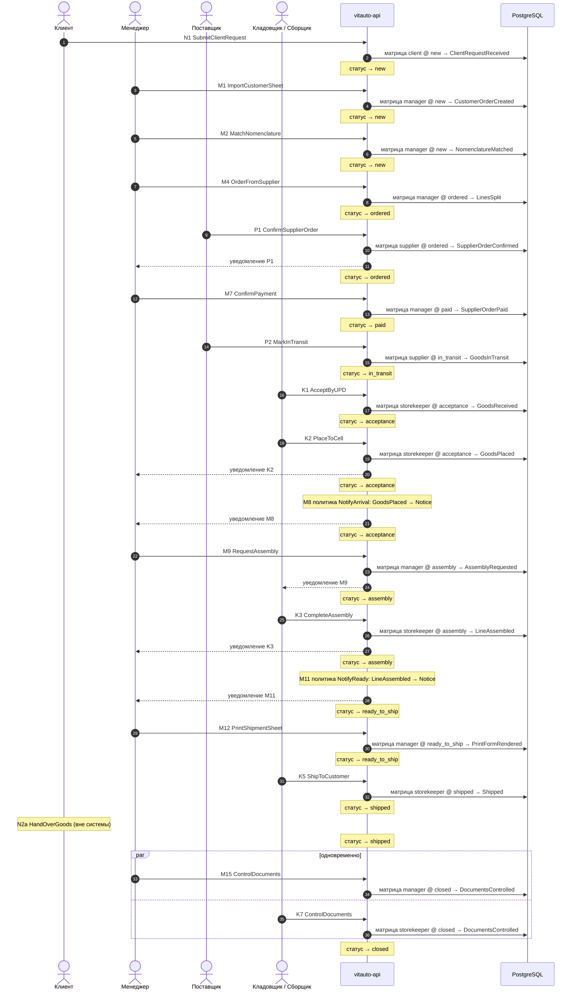

| № | Узел | Роль | Команда | API | Статус | Может менять (матрица) | События | Тесты |
|---|---|---|---|---|---|---|---|---|
| 1 | N1 Заявка: Excel / фото | client | SubmitClientRequest | POST /imports (kind=customer_sheet); сейчас POST /sales/imports | new | Т1 | ClientRequestReceived | T-N1, S-happy |
| 2 | M1 Загрузка заявки в 1С | manager | ImportCustomerSheet | POST /sales/imports; POST /lines | new | В5, В6, В7, В8, Е2, Е3, Е4, Е5, Е6, Е7, К1, К2, К3, К6, К7 | CustomerOrderCreated, LinesCreated | T-M1, S-happy |
| 3 | M2 Поиск + подбор номенклатуры | manager | MatchNomenclature | GET /catalog/goods; PATCH /lines/{id} {field: Номенклатура} | new | М1, Н0, Р0, Т1 | NomenclatureMatched, LineChanged | T-M2, S-happy |
| 4 | M4 Заказ поставщику | manager | OrderFromSupplier | POST /sales/jobs; POST /sales/supplier-orders | ordered | С1, О1, Н5, Т1 | LinesSplit, SupplierOrderPlaced, LineStatusChanged | T-M4, S-happy |
| 5 | P1 Обработка заказа | supplier | ConfirmSupplierOrder | POST /supplier/orders/{id}/confirm (портал поставщика) | ordered | только чтение | SupplierOrderConfirmed | T-P1, S-happy |
| 6 | M7 Контроль оплаты | manager | ConfirmPayment | POST /supply/status {status: paid} | paid | О5 | SupplierOrderPaid, LineStatusChanged | T-M7, S-happy |
| 7 | P2 Отгрузка → В пути | supplier | MarkInTransit | POST /supply/status {status: in_transit} | in_transit | Т1 | GoodsInTransit, LineStatusChanged | T-P2, S-happy |
| 8 | K1 Приёмка (УПД) | storekeeper | AcceptByUPD | POST /lines/transition {to: acceptance}; PATCH /lines/{id} {ДатаУПД, НомерУПД} | acceptance | С1, С2, С3, С4, С5, С7 | GoodsReceived, LineStatusChanged | T-K1, S-happy |
| 9 | K2 Размещение по складам | storekeeper | PlaceToCell | POST /stock/placements {warehouseId, cellId, lineIds} | acceptance | только чтение | GoodsPlaced, LineStatusChanged | T-K2, S-happy |
| 10 | M8 Уведомление о приходе | manager | NotifyArrival | policy: GoodsPlaced → Notice; GET /notifications | acceptance | Н5 | NoticeCreated | T-M8, S-happy |
| 11 | M9 Задание на комплектацию | manager | RequestAssembly | POST /lines/transition {to: assembly} | assembly | Н5, Н4 | AssemblyRequested, LineStatusChanged | T-M9, S-stock |
| 12 | K3 Комплектация + сборочный лист | storekeeper | CompleteAssembly | POST /lines/transition {to: ready_to_ship}; POST /print {kind: assembly_sheet} | assembly | только чтение | LineAssembled, PrintFormRendered, LineStatusChanged | T-K3, S-stock |
| 13 | M11 Уведомление о готовности | manager | NotifyReady | policy: LineAssembled → Notice; GET /notifications | ready_to_ship | Н5 | NoticeCreated | T-M11, S-happy |
| 14 | M12 Отгрузочная ведомость | manager | PrintShipmentSheet | POST /print {kind: shipment_sheet} | ready_to_ship | В1 | PrintFormRendered | T-M12, S-happy |
| 15 | K5 Отгрузка клиенту / ТК | storekeeper | ShipToCustomer | POST /sales/shipments {shipmentDate, shipmentNumber} | shipped | только чтение | Shipped, LineStatusChanged | T-K5, S-happy |
| 16 | N2a Получение товара | client | HandOverGoods | физическая выдача товара; в системе фиксируется отгрузкой K5 | shipped | только чтение |  | T-N2a, S-happy |
| 17 | M15 Контроль документов | manager | ControlDocuments | PATCH /lines/{id} {field: ДокументПодписанОригинал}; POST /lines/transition {to: closed} | closed | Т1 | DocumentsControlled, LineStatusChanged | T-M15, S-happy |
| 17 | K7 Контроль документов | storekeeper | ControlDocuments | PATCH /lines/{id} {field: ДокументПодписанОригинал}; POST /lines/transition {to: closed} | closed | Т1 | DocumentsControlled | T-K7, S-happy |

### Со склада (резерв) (`stock`)

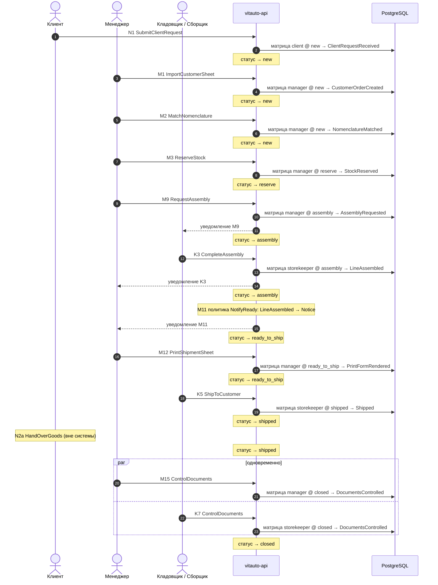

| № | Узел | Роль | Команда | API | Статус | Может менять (матрица) | События | Тесты |
|---|---|---|---|---|---|---|---|---|
| 1 | N1 Заявка: Excel / фото | client | SubmitClientRequest | POST /imports (kind=customer_sheet); сейчас POST /sales/imports | new | Т1 | ClientRequestReceived | T-N1, S-happy |
| 2 | M1 Загрузка заявки в 1С | manager | ImportCustomerSheet | POST /sales/imports; POST /lines | new | В5, В6, В7, В8, Е2, Е3, Е4, Е5, Е6, Е7, К1, К2, К3, К6, К7 | CustomerOrderCreated, LinesCreated | T-M1, S-happy |
| 3 | M2 Поиск + подбор номенклатуры | manager | MatchNomenclature | GET /catalog/goods; PATCH /lines/{id} {field: Номенклатура} | new | М1, Н0, Р0, Т1 | NomenclatureMatched, LineChanged | T-M2, S-happy |
| 4 | M3 Резервирование на складе | manager | ReserveStock | POST /lines/transition {to: reserve} | reserve | Н4 | StockReserved, LineStatusChanged | T-M3, S-stock, S-mixed_order |
| 5 | M9 Задание на комплектацию | manager | RequestAssembly | POST /lines/transition {to: assembly} | assembly | Н5, Н4 | AssemblyRequested, LineStatusChanged | T-M9, S-stock |
| 6 | K3 Комплектация + сборочный лист | storekeeper | CompleteAssembly | POST /lines/transition {to: ready_to_ship}; POST /print {kind: assembly_sheet} | assembly | только чтение | LineAssembled, PrintFormRendered, LineStatusChanged | T-K3, S-stock |
| 7 | M11 Уведомление о готовности | manager | NotifyReady | policy: LineAssembled → Notice; GET /notifications | ready_to_ship | Н5 | NoticeCreated | T-M11, S-happy |
| 8 | M12 Отгрузочная ведомость | manager | PrintShipmentSheet | POST /print {kind: shipment_sheet} | ready_to_ship | В1 | PrintFormRendered | T-M12, S-happy |
| 9 | K5 Отгрузка клиенту / ТК | storekeeper | ShipToCustomer | POST /sales/shipments {shipmentDate, shipmentNumber} | shipped | только чтение | Shipped, LineStatusChanged | T-K5, S-happy |
| 10 | N2a Получение товара | client | HandOverGoods | физическая выдача товара; в системе фиксируется отгрузкой K5 | shipped | только чтение |  | T-N2a, S-happy |
| 11 | M15 Контроль документов | manager | ControlDocuments | PATCH /lines/{id} {field: ДокументПодписанОригинал}; POST /lines/transition {to: closed} | closed | Т1 | DocumentsControlled, LineStatusChanged | T-M15, S-happy |
| 11 | K7 Контроль документов | storekeeper | ControlDocuments | PATCH /lines/{id} {field: ДокументПодписанОригинал}; POST /lines/transition {to: closed} | closed | Т1 | DocumentsControlled | T-K7, S-happy |

### Смешанный заказ (склад + закупка) (`mixed_order`)

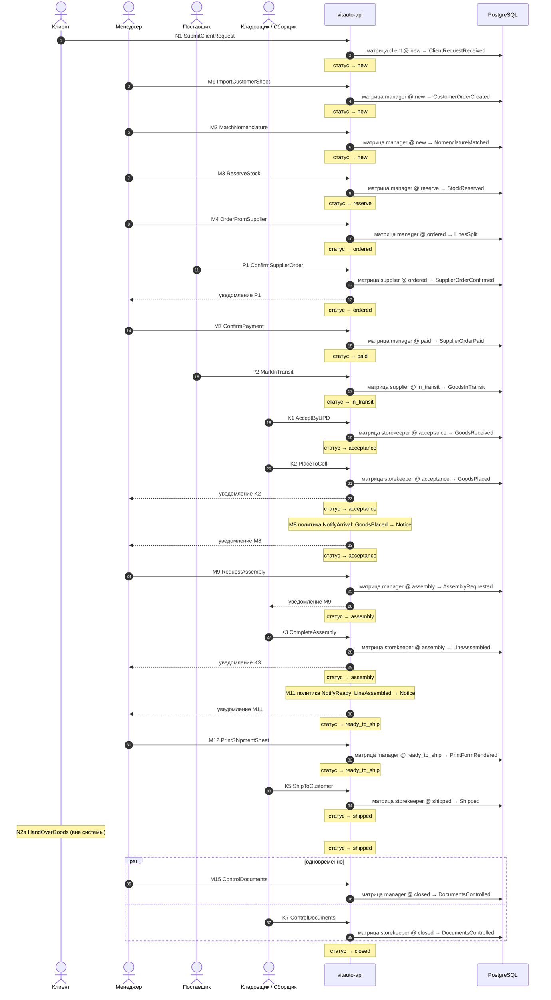

| № | Узел | Роль | Команда | API | Статус | Может менять (матрица) | События | Тесты |
|---|---|---|---|---|---|---|---|---|
| 1 | N1 Заявка: Excel / фото | client | SubmitClientRequest | POST /imports (kind=customer_sheet); сейчас POST /sales/imports | new | Т1 | ClientRequestReceived | T-N1, S-happy |
| 2 | M1 Загрузка заявки в 1С | manager | ImportCustomerSheet | POST /sales/imports; POST /lines | new | В5, В6, В7, В8, Е2, Е3, Е4, Е5, Е6, Е7, К1, К2, К3, К6, К7 | CustomerOrderCreated, LinesCreated | T-M1, S-happy |
| 3 | M2 Поиск + подбор номенклатуры | manager | MatchNomenclature | GET /catalog/goods; PATCH /lines/{id} {field: Номенклатура} | new | М1, Н0, Р0, Т1 | NomenclatureMatched, LineChanged | T-M2, S-happy |
| 4 | M3 Резервирование на складе | manager | ReserveStock | POST /lines/transition {to: reserve} | reserve | Н4 | StockReserved, LineStatusChanged | T-M3, S-stock, S-mixed_order |
| 5 | M4 Заказ поставщику | manager | OrderFromSupplier | POST /sales/jobs; POST /sales/supplier-orders | ordered | С1, О1, Н5, Т1 | LinesSplit, SupplierOrderPlaced, LineStatusChanged | T-M4, S-happy |
| 6 | P1 Обработка заказа | supplier | ConfirmSupplierOrder | POST /supplier/orders/{id}/confirm (портал поставщика) | ordered | только чтение | SupplierOrderConfirmed | T-P1, S-happy |
| 7 | M7 Контроль оплаты | manager | ConfirmPayment | POST /supply/status {status: paid} | paid | О5 | SupplierOrderPaid, LineStatusChanged | T-M7, S-happy |
| 8 | P2 Отгрузка → В пути | supplier | MarkInTransit | POST /supply/status {status: in_transit} | in_transit | Т1 | GoodsInTransit, LineStatusChanged | T-P2, S-happy |
| 9 | K1 Приёмка (УПД) | storekeeper | AcceptByUPD | POST /lines/transition {to: acceptance}; PATCH /lines/{id} {ДатаУПД, НомерУПД} | acceptance | С1, С2, С3, С4, С5, С7 | GoodsReceived, LineStatusChanged | T-K1, S-happy |
| 10 | K2 Размещение по складам | storekeeper | PlaceToCell | POST /stock/placements {warehouseId, cellId, lineIds} | acceptance | только чтение | GoodsPlaced, LineStatusChanged | T-K2, S-happy |
| 11 | M8 Уведомление о приходе | manager | NotifyArrival | policy: GoodsPlaced → Notice; GET /notifications | acceptance | Н5 | NoticeCreated | T-M8, S-happy |
| 12 | M9 Задание на комплектацию | manager | RequestAssembly | POST /lines/transition {to: assembly} | assembly | Н5, Н4 | AssemblyRequested, LineStatusChanged | T-M9, S-stock |
| 13 | K3 Комплектация + сборочный лист | storekeeper | CompleteAssembly | POST /lines/transition {to: ready_to_ship}; POST /print {kind: assembly_sheet} | assembly | только чтение | LineAssembled, PrintFormRendered, LineStatusChanged | T-K3, S-stock |
| 14 | M11 Уведомление о готовности | manager | NotifyReady | policy: LineAssembled → Notice; GET /notifications | ready_to_ship | Н5 | NoticeCreated | T-M11, S-happy |
| 15 | M12 Отгрузочная ведомость | manager | PrintShipmentSheet | POST /print {kind: shipment_sheet} | ready_to_ship | В1 | PrintFormRendered | T-M12, S-happy |
| 16 | K5 Отгрузка клиенту / ТК | storekeeper | ShipToCustomer | POST /sales/shipments {shipmentDate, shipmentNumber} | shipped | только чтение | Shipped, LineStatusChanged | T-K5, S-happy |
| 17 | N2a Получение товара | client | HandOverGoods | физическая выдача товара; в системе фиксируется отгрузкой K5 | shipped | только чтение |  | T-N2a, S-happy |
| 18 | M15 Контроль документов | manager | ControlDocuments | PATCH /lines/{id} {field: ДокументПодписанОригинал}; POST /lines/transition {to: closed} | closed | Т1 | DocumentsControlled, LineStatusChanged | T-M15, S-happy |
| 18 | K7 Контроль документов | storekeeper | ControlDocuments | PATCH /lines/{id} {field: ДокументПодписанОригинал}; POST /lines/transition {to: closed} | closed | Т1 | DocumentsControlled | T-K7, S-happy |

### Самовывоз у внешнего поставщика клиентом (`delivery_split`)

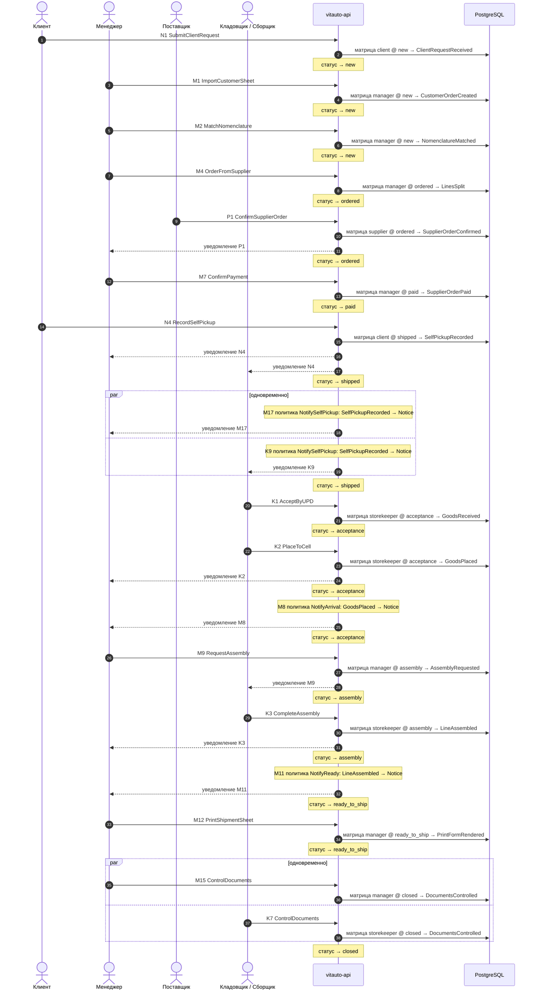

| № | Узел | Роль | Команда | API | Статус | Может менять (матрица) | События | Тесты |
|---|---|---|---|---|---|---|---|---|
| 1 | N1 Заявка: Excel / фото | client | SubmitClientRequest | POST /imports (kind=customer_sheet); сейчас POST /sales/imports | new | Т1 | ClientRequestReceived | T-N1, S-happy |
| 2 | M1 Загрузка заявки в 1С | manager | ImportCustomerSheet | POST /sales/imports; POST /lines | new | В5, В6, В7, В8, Е2, Е3, Е4, Е5, Е6, Е7, К1, К2, К3, К6, К7 | CustomerOrderCreated, LinesCreated | T-M1, S-happy |
| 3 | M2 Поиск + подбор номенклатуры | manager | MatchNomenclature | GET /catalog/goods; PATCH /lines/{id} {field: Номенклатура} | new | М1, Н0, Р0, Т1 | NomenclatureMatched, LineChanged | T-M2, S-happy |
| 4 | M4 Заказ поставщику | manager | OrderFromSupplier | POST /sales/jobs; POST /sales/supplier-orders | ordered | С1, О1, Н5, Т1 | LinesSplit, SupplierOrderPlaced, LineStatusChanged | T-M4, S-happy |
| 5 | P1 Обработка заказа | supplier | ConfirmSupplierOrder | POST /supplier/orders/{id}/confirm (портал поставщика) | ordered | только чтение | SupplierOrderConfirmed | T-P1, S-happy |
| 6 | M7 Контроль оплаты | manager | ConfirmPayment | POST /supply/status {status: paid} | paid | О5 | SupplierOrderPaid, LineStatusChanged | T-M7, S-happy |
| 7 | N4 Самовывоз у внешнего поставщика | client | RecordSelfPickup | POST /lines/transition {to: shipped} | shipped | Т1 | SelfPickupRecorded, LineStatusChanged | T-N4, S-delivery_split |
| 8 | M17 Уведомление о самовывозе | manager | NotifySelfPickup | policy: SelfPickupRecorded → Notice | shipped | Т1 | NoticeCreated | T-M17, S-delivery_split |
| 8 | K9 Уведомление о самовывозе | storekeeper | NotifySelfPickup | policy: SelfPickupRecorded → Notice | shipped | Т1 | NoticeCreated | T-K9, S-delivery_split |
| 9 | K1 Приёмка (УПД) | storekeeper | AcceptByUPD | POST /lines/transition {to: acceptance}; PATCH /lines/{id} {ДатаУПД, НомерУПД} | acceptance | С1, С2, С3, С4, С5, С7 | GoodsReceived, LineStatusChanged | T-K1, S-happy |
| 10 | K2 Размещение по складам | storekeeper | PlaceToCell | POST /stock/placements {warehouseId, cellId, lineIds} | acceptance | только чтение | GoodsPlaced, LineStatusChanged | T-K2, S-happy |
| 11 | M8 Уведомление о приходе | manager | NotifyArrival | policy: GoodsPlaced → Notice; GET /notifications | acceptance | Н5 | NoticeCreated | T-M8, S-happy |
| 12 | M9 Задание на комплектацию | manager | RequestAssembly | POST /lines/transition {to: assembly} | assembly | Н5, Н4 | AssemblyRequested, LineStatusChanged | T-M9, S-stock |
| 13 | K3 Комплектация + сборочный лист | storekeeper | CompleteAssembly | POST /lines/transition {to: ready_to_ship}; POST /print {kind: assembly_sheet} | assembly | только чтение | LineAssembled, PrintFormRendered, LineStatusChanged | T-K3, S-stock |
| 14 | M11 Уведомление о готовности | manager | NotifyReady | policy: LineAssembled → Notice; GET /notifications | ready_to_ship | Н5 | NoticeCreated | T-M11, S-happy |
| 15 | M12 Отгрузочная ведомость | manager | PrintShipmentSheet | POST /print {kind: shipment_sheet} | ready_to_ship | В1 | PrintFormRendered | T-M12, S-happy |
| 16 | M15 Контроль документов | manager | ControlDocuments | PATCH /lines/{id} {field: ДокументПодписанОригинал}; POST /lines/transition {to: closed} | closed | Т1 | DocumentsControlled, LineStatusChanged | T-M15, S-happy |
| 16 | K7 Контроль документов | storekeeper | ControlDocuments | PATCH /lines/{id} {field: ДокументПодписанОригинал}; POST /lines/transition {to: closed} | closed | Т1 | DocumentsControlled | T-K7, S-happy |

## B. Закупка и поставка (исключения)

### Виртуальный закуп (менеджер → админ) (`virtual_buy`)

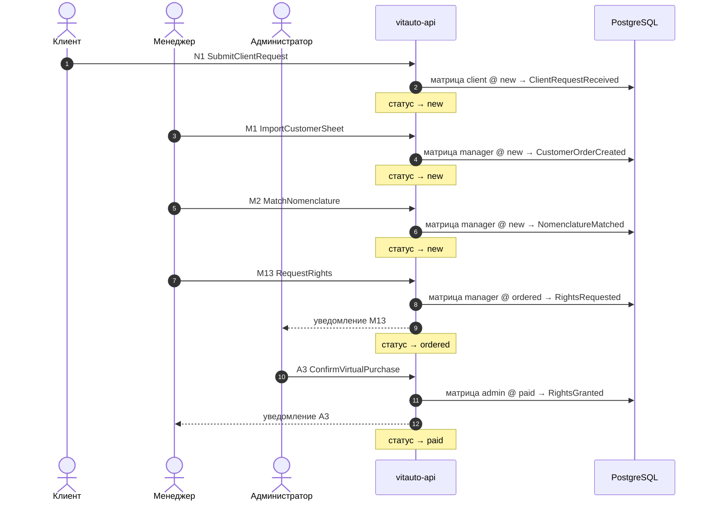

| № | Узел | Роль | Команда | API | Статус | Может менять (матрица) | События | Тесты |
|---|---|---|---|---|---|---|---|---|
| 1 | N1 Заявка: Excel / фото | client | SubmitClientRequest | POST /imports (kind=customer_sheet); сейчас POST /sales/imports | new | Т1 | ClientRequestReceived | T-N1, S-happy |
| 2 | M1 Загрузка заявки в 1С | manager | ImportCustomerSheet | POST /sales/imports; POST /lines | new | В5, В6, В7, В8, Е2, Е3, Е4, Е5, Е6, Е7, К1, К2, К3, К6, К7 | CustomerOrderCreated, LinesCreated | T-M1, S-happy |
| 3 | M2 Поиск + подбор номенклатуры | manager | MatchNomenclature | GET /catalog/goods; PATCH /lines/{id} {field: Номенклатура} | new | М1, Н0, Р0, Т1 | NomenclatureMatched, LineChanged | T-M2, S-happy |
| 4 | M13 Недостаточно прав, обратись к админу | manager | RequestRights | POST /access-requests | ordered | Т1 | RightsRequested | T-M13, S-virtual_buy |
| 5 | A3 Подтверждение чека админом | admin | ConfirmVirtualPurchase | POST /access-requests/{id}/approve | paid | Т1, О1, С1 | RightsGranted, VirtualPurchaseConfirmed, LineStatusChanged | T-A3, S-virtual_buy |

### Контроль комплектации → снова задание (продолжение A) (`defect`)

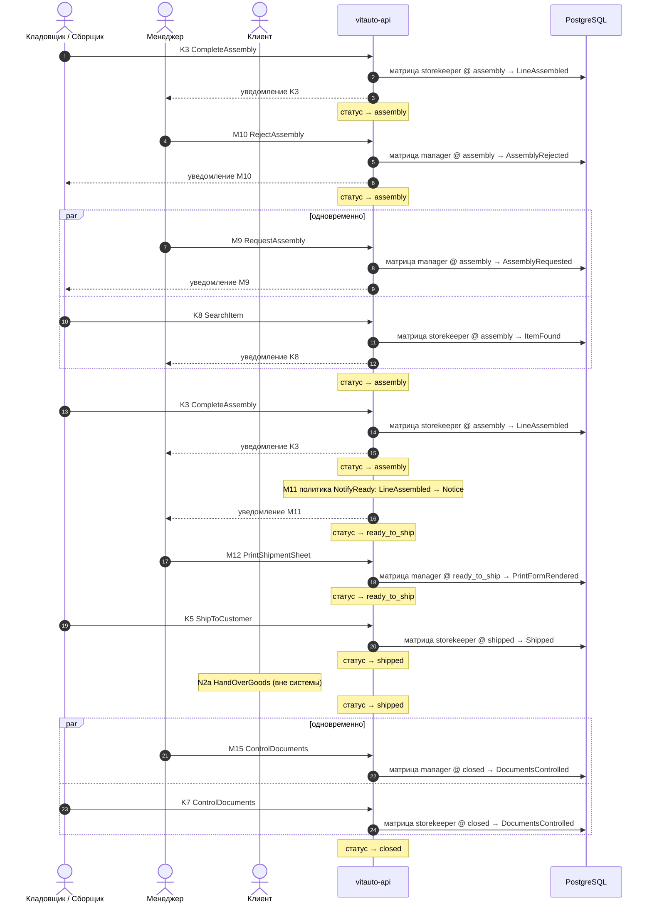

| № | Узел | Роль | Команда | API | Статус | Может менять (матрица) | События | Тесты |
|---|---|---|---|---|---|---|---|---|
| 1 | K3 Комплектация + сборочный лист | storekeeper | CompleteAssembly | POST /lines/transition {to: ready_to_ship}; POST /print {kind: assembly_sheet} | assembly | только чтение | LineAssembled, PrintFormRendered, LineStatusChanged | T-K3, S-stock |
| 2 | M10 Контроль комплектации | manager | RejectAssembly | POST /lines/reject-assembly {reason} | assembly | Н5, Т1 | AssemblyRejected, LineStatusChanged | T-M10, S-defect |
| 3 | M9 Задание на комплектацию | manager | RequestAssembly | POST /lines/transition {to: assembly} | assembly | Н5, Н4 | AssemblyRequested, LineStatusChanged | T-M9, S-stock |
| 3 | K8 Розыск позиции | storekeeper | SearchItem | POST /stock/searches {lineId} | assembly | Т1 | ItemFound, ItemUnidentified | T-K8, S-defect |
| 4 | K3 Комплектация + сборочный лист | storekeeper | CompleteAssembly | POST /lines/transition {to: ready_to_ship}; POST /print {kind: assembly_sheet} | assembly | только чтение | LineAssembled, PrintFormRendered, LineStatusChanged | T-K3, S-stock |
| 5 | M11 Уведомление о готовности | manager | NotifyReady | policy: LineAssembled → Notice; GET /notifications | ready_to_ship | Н5 | NoticeCreated | T-M11, S-happy |
| 6 | M12 Отгрузочная ведомость | manager | PrintShipmentSheet | POST /print {kind: shipment_sheet} | ready_to_ship | В1 | PrintFormRendered | T-M12, S-happy |
| 7 | K5 Отгрузка клиенту / ТК | storekeeper | ShipToCustomer | POST /sales/shipments {shipmentDate, shipmentNumber} | shipped | только чтение | Shipped, LineStatusChanged | T-K5, S-happy |
| 8 | N2a Получение товара | client | HandOverGoods | физическая выдача товара; в системе фиксируется отгрузкой K5 | shipped | только чтение |  | T-N2a, S-happy |
| 9 | M15 Контроль документов | manager | ControlDocuments | PATCH /lines/{id} {field: ДокументПодписанОригинал}; POST /lines/transition {to: closed} | closed | Т1 | DocumentsControlled, LineStatusChanged | T-M15, S-happy |
| 9 | K7 Контроль документов | storekeeper | ControlDocuments | PATCH /lines/{id} {field: ДокументПодписанОригинал}; POST /lines/transition {to: closed} | closed | Т1 | DocumentsControlled | T-K7, S-happy |

### Отмена заказа у поставщика (`cancel_supplier`)

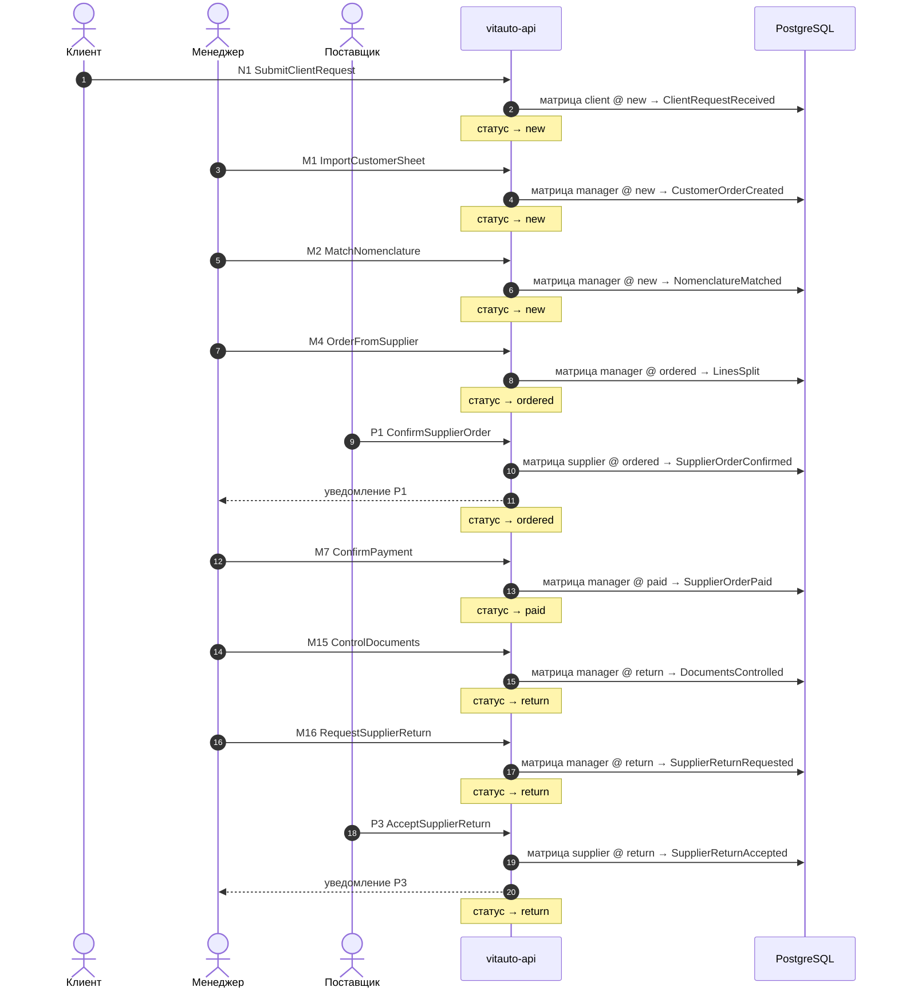

| № | Узел | Роль | Команда | API | Статус | Может менять (матрица) | События | Тесты |
|---|---|---|---|---|---|---|---|---|
| 1 | N1 Заявка: Excel / фото | client | SubmitClientRequest | POST /imports (kind=customer_sheet); сейчас POST /sales/imports | new | Т1 | ClientRequestReceived | T-N1, S-happy |
| 2 | M1 Загрузка заявки в 1С | manager | ImportCustomerSheet | POST /sales/imports; POST /lines | new | В5, В6, В7, В8, Е2, Е3, Е4, Е5, Е6, Е7, К1, К2, К3, К6, К7 | CustomerOrderCreated, LinesCreated | T-M1, S-happy |
| 3 | M2 Поиск + подбор номенклатуры | manager | MatchNomenclature | GET /catalog/goods; PATCH /lines/{id} {field: Номенклатура} | new | М1, Н0, Р0, Т1 | NomenclatureMatched, LineChanged | T-M2, S-happy |
| 4 | M4 Заказ поставщику | manager | OrderFromSupplier | POST /sales/jobs; POST /sales/supplier-orders | ordered | С1, О1, Н5, Т1 | LinesSplit, SupplierOrderPlaced, LineStatusChanged | T-M4, S-happy |
| 5 | P1 Обработка заказа | supplier | ConfirmSupplierOrder | POST /supplier/orders/{id}/confirm (портал поставщика) | ordered | только чтение | SupplierOrderConfirmed | T-P1, S-happy |
| 6 | M7 Контроль оплаты | manager | ConfirmPayment | POST /supply/status {status: paid} | paid | О5 | SupplierOrderPaid, LineStatusChanged | T-M7, S-happy |
| 7 | M15 Контроль документов | manager | ControlDocuments | PATCH /lines/{id} {field: ДокументПодписанОригинал}; POST /lines/transition {to: closed} | return | А3, Т1 | DocumentsControlled, LineStatusChanged | T-M15, S-happy |
| 8 | M16 Заявка на возврат поставщику | manager | RequestSupplierReturn | POST /returns {direction: supplier} | return | Т1 | SupplierReturnRequested | T-M16, S-return_mgr, S-cancel_supplier |
| 9 | P3 Приём возврата | supplier | AcceptSupplierReturn | POST /returns/{id}/supplier-accepted | return | только чтение | SupplierReturnAccepted | T-P3, S-return |

## C. Возвраты

### Возврат от клиента (`return`)

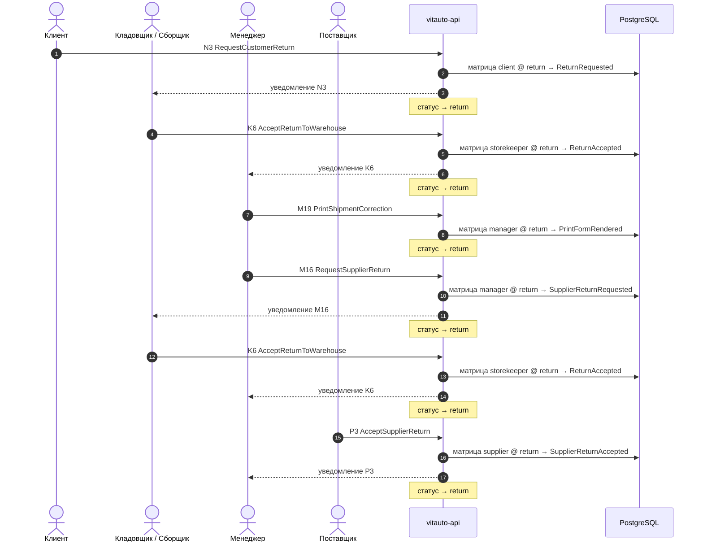

| № | Узел | Роль | Команда | API | Статус | Может менять (матрица) | События | Тесты |
|---|---|---|---|---|---|---|---|---|
| 1 | N3 Возврат товара | client | RequestCustomerReturn | POST /lines/transition {to: return} | return | Т1 | ReturnRequested, LineStatusChanged | T-N3, S-return, S-return_internal |
| 2 | K6 Приёмка / подготовка возврата | storekeeper | AcceptReturnToWarehouse | POST /lines/transition {to: return} | return | Т1 | ReturnAccepted, LineStatusChanged | T-K6, S-return |
| 3 | M19 Отгрузочная ведомость (корректировка) | manager | PrintShipmentCorrection | POST /print {kind: shipment_correction} | return | Т1 | PrintFormRendered | T-M19, S-return |
| 4 | M16 Заявка на возврат поставщику | manager | RequestSupplierReturn | POST /returns {direction: supplier} | return | Т1 | SupplierReturnRequested | T-M16, S-return_mgr, S-cancel_supplier |
| 5 | K6 Приёмка / подготовка возврата | storekeeper | AcceptReturnToWarehouse | POST /lines/transition {to: return} | return | Т1 | ReturnAccepted, LineStatusChanged | T-K6, S-return |
| 6 | P3 Приём возврата | supplier | AcceptSupplierReturn | POST /returns/{id}/supplier-accepted | return | только чтение | SupplierReturnAccepted | T-P3, S-return |

### Возврат поставщику (от менеджера) (`return_mgr`)

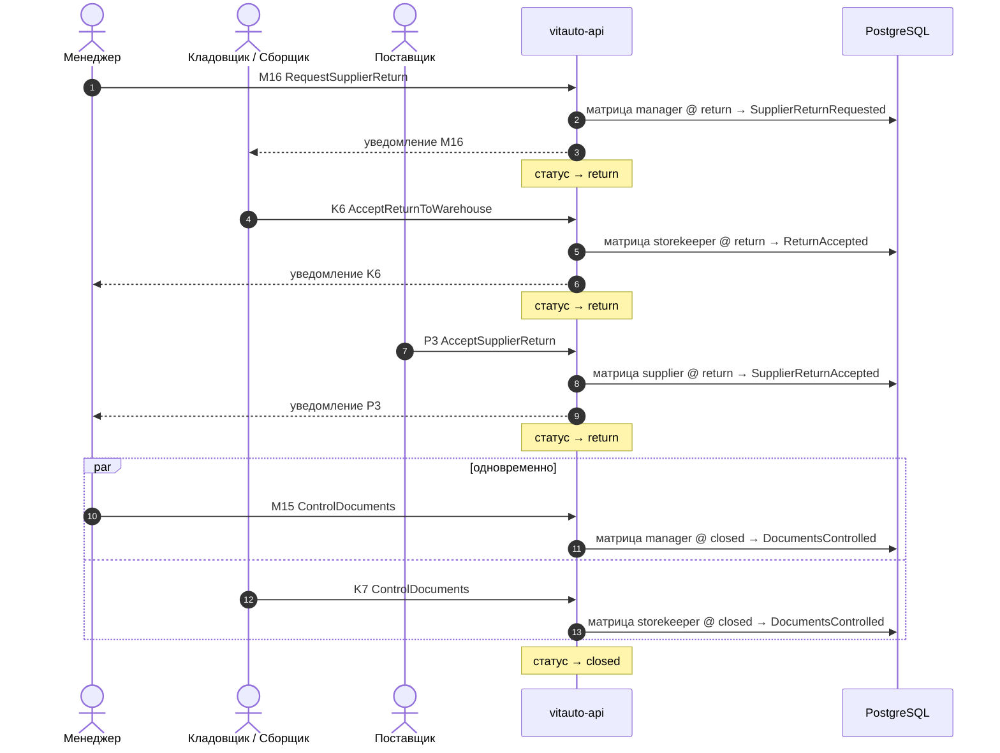

| № | Узел | Роль | Команда | API | Статус | Может менять (матрица) | События | Тесты |
|---|---|---|---|---|---|---|---|---|
| 1 | M16 Заявка на возврат поставщику | manager | RequestSupplierReturn | POST /returns {direction: supplier} | return | Т1 | SupplierReturnRequested | T-M16, S-return_mgr, S-cancel_supplier |
| 2 | K6 Приёмка / подготовка возврата | storekeeper | AcceptReturnToWarehouse | POST /lines/transition {to: return} | return | Т1 | ReturnAccepted, LineStatusChanged | T-K6, S-return |
| 3 | P3 Приём возврата | supplier | AcceptSupplierReturn | POST /returns/{id}/supplier-accepted | return | только чтение | SupplierReturnAccepted | T-P3, S-return |
| 4 | M15 Контроль документов | manager | ControlDocuments | PATCH /lines/{id} {field: ДокументПодписанОригинал}; POST /lines/transition {to: closed} | closed | Т1 | DocumentsControlled, LineStatusChanged | T-M15, S-happy |
| 4 | K7 Контроль документов | storekeeper | ControlDocuments | PATCH /lines/{id} {field: ДокументПодписанОригинал}; POST /lines/transition {to: closed} | closed | Т1 | DocumentsControlled | T-K7, S-happy |

### Отказ клиента при получении товара (`return_internal`)

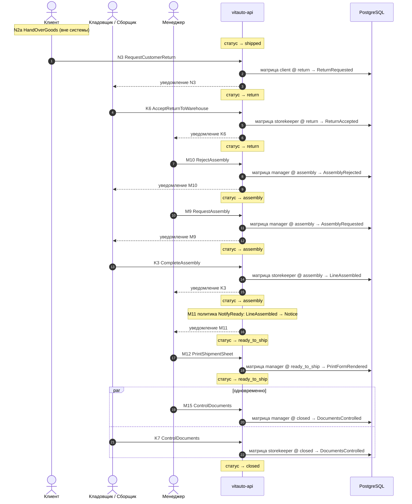

| № | Узел | Роль | Команда | API | Статус | Может менять (матрица) | События | Тесты |
|---|---|---|---|---|---|---|---|---|
| 1 | N2a Получение товара | client | HandOverGoods | физическая выдача товара; в системе фиксируется отгрузкой K5 | shipped | только чтение |  | T-N2a, S-happy |
| 2 | N3 Возврат товара | client | RequestCustomerReturn | POST /lines/transition {to: return} | return | Т1 | ReturnRequested, LineStatusChanged | T-N3, S-return, S-return_internal |
| 3 | K6 Приёмка / подготовка возврата | storekeeper | AcceptReturnToWarehouse | POST /lines/transition {to: return} | return | Т1 | ReturnAccepted, LineStatusChanged | T-K6, S-return |
| 4 | M10 Контроль комплектации | manager | RejectAssembly | POST /lines/reject-assembly {reason} | assembly | Н5, Т1 | AssemblyRejected, LineStatusChanged | T-M10, S-defect |
| 5 | M9 Задание на комплектацию | manager | RequestAssembly | POST /lines/transition {to: assembly} | assembly | Н5, Н4 | AssemblyRequested, LineStatusChanged | T-M9, S-stock |
| 6 | K3 Комплектация + сборочный лист | storekeeper | CompleteAssembly | POST /lines/transition {to: ready_to_ship}; POST /print {kind: assembly_sheet} | assembly | только чтение | LineAssembled, PrintFormRendered, LineStatusChanged | T-K3, S-stock |
| 7 | M11 Уведомление о готовности | manager | NotifyReady | policy: LineAssembled → Notice; GET /notifications | ready_to_ship | Н5 | NoticeCreated | T-M11, S-happy |
| 8 | M12 Отгрузочная ведомость | manager | PrintShipmentSheet | POST /print {kind: shipment_sheet} | ready_to_ship | В1 | PrintFormRendered | T-M12, S-happy |
| 9 | M15 Контроль документов | manager | ControlDocuments | PATCH /lines/{id} {field: ДокументПодписанОригинал}; POST /lines/transition {to: closed} | closed | Т1 | DocumentsControlled, LineStatusChanged | T-M15, S-happy |
| 9 | K7 Контроль документов | storekeeper | ControlDocuments | PATCH /lines/{id} {field: ДокументПодписанОригинал}; POST /lines/transition {to: closed} | closed | Т1 | DocumentsControlled | T-K7, S-happy |

## E. Главный механик

### Поступление машины в ремонт (`car_repair_in`)

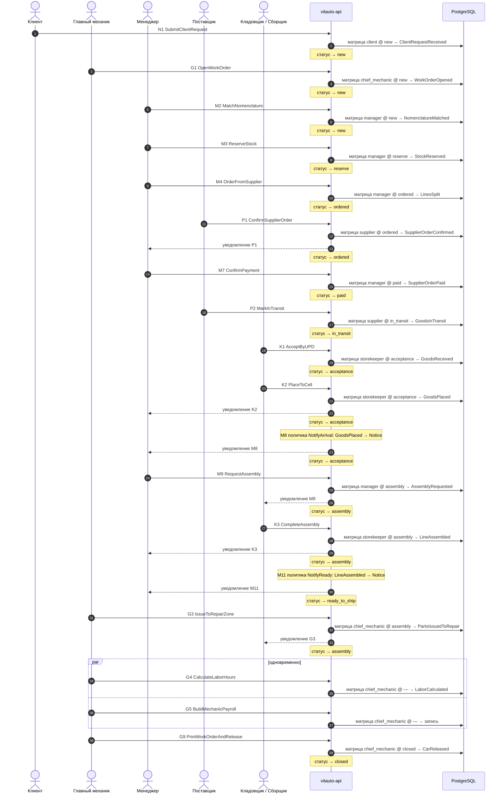

| № | Узел | Роль | Команда | API | Статус | Может менять (матрица) | События | Тесты |
|---|---|---|---|---|---|---|---|---|
| 1 | N1 Заявка: Excel / фото | client | SubmitClientRequest | POST /imports (kind=customer_sheet); сейчас POST /sales/imports | new | Т1 | ClientRequestReceived | T-N1, S-happy |
| 2 | G1 Открытие заказ-наряда | chief_mechanic | OpenWorkOrder | POST /work-orders | new | В5, В6, В7, В8, Е1, Е2, Е3, Е4, Е6, Е7, К1, К2, К3, К6, К7 | WorkOrderOpened | T-G1, S-car_repair_in |
| 3 | M2 Поиск + подбор номенклатуры | manager | MatchNomenclature | GET /catalog/goods; PATCH /lines/{id} {field: Номенклатура} | new | М1, Н0, Р0, Т1 | NomenclatureMatched, LineChanged | T-M2, S-happy |
| 4 | M3 Резервирование на складе | manager | ReserveStock | POST /lines/transition {to: reserve} | reserve | Н4 | StockReserved, LineStatusChanged | T-M3, S-stock, S-mixed_order |
| 5 | M4 Заказ поставщику | manager | OrderFromSupplier | POST /sales/jobs; POST /sales/supplier-orders | ordered | С1, О1, Н5, Т1 | LinesSplit, SupplierOrderPlaced, LineStatusChanged | T-M4, S-happy |
| 6 | P1 Обработка заказа | supplier | ConfirmSupplierOrder | POST /supplier/orders/{id}/confirm (портал поставщика) | ordered | только чтение | SupplierOrderConfirmed | T-P1, S-happy |
| 7 | M7 Контроль оплаты | manager | ConfirmPayment | POST /supply/status {status: paid} | paid | О5 | SupplierOrderPaid, LineStatusChanged | T-M7, S-happy |
| 8 | P2 Отгрузка → В пути | supplier | MarkInTransit | POST /supply/status {status: in_transit} | in_transit | Т1 | GoodsInTransit, LineStatusChanged | T-P2, S-happy |
| 9 | K1 Приёмка (УПД) | storekeeper | AcceptByUPD | POST /lines/transition {to: acceptance}; PATCH /lines/{id} {ДатаУПД, НомерУПД} | acceptance | С1, С2, С3, С4, С5, С7 | GoodsReceived, LineStatusChanged | T-K1, S-happy |
| 10 | K2 Размещение по складам | storekeeper | PlaceToCell | POST /stock/placements {warehouseId, cellId, lineIds} | acceptance | только чтение | GoodsPlaced, LineStatusChanged | T-K2, S-happy |
| 11 | M8 Уведомление о приходе | manager | NotifyArrival | policy: GoodsPlaced → Notice; GET /notifications | acceptance | Н5 | NoticeCreated | T-M8, S-happy |
| 12 | M9 Задание на комплектацию | manager | RequestAssembly | POST /lines/transition {to: assembly} | assembly | Н5, Н4 | AssemblyRequested, LineStatusChanged | T-M9, S-stock |
| 13 | K3 Комплектация + сборочный лист | storekeeper | CompleteAssembly | POST /lines/transition {to: ready_to_ship}; POST /print {kind: assembly_sheet} | assembly | только чтение | LineAssembled, PrintFormRendered, LineStatusChanged | T-K3, S-stock |
| 14 | M11 Уведомление о готовности | manager | NotifyReady | policy: LineAssembled → Notice; GET /notifications | ready_to_ship | Н5 | NoticeCreated | T-M11, S-happy |
| 15 | G3 Выдача в ремонтную зону | chief_mechanic | IssueToRepairZone | POST /lines/transition {to: assembly} | assembly | Н4 | PartsIssuedToRepair, LineStatusChanged | T-G3, S-car_repair_in |
| 16 | G4 Нормо-часы | chief_mechanic | CalculateLaborHours | PUT /work-orders/{id}/labor | — | — | LaborCalculated | T-G4, S-car_repair_in |
| 16 | G5 Зарплатный фонд | chief_mechanic | BuildMechanicPayroll | GET /work-orders/payroll?period= | — | — |  | T-G5, S-car_repair_in |
| 17 | G9 Печать комплекта документов и выдача авто | chief_mechanic | PrintWorkOrderAndRelease | POST /print {kind: work_order_set}; POST /lines/transition {to: closed} | closed | Т1 | CarReleased, PrintFormRendered, LineStatusChanged | T-G9, S-car_repair_in |

## Наблюдения: шаги, где матрица не даёт роли менять колонки своего узла

Команда узла выполняется сервером (статус, документ), но поля узла роль руками не меняет. Проверить с заказчиком при переносе матрицы (этап 4): это намеренно или пробел матрицы.

| Узел | Роль | Статус | Колонки узла | Команда |
|---|---|---|---|---|
| P1 Обработка заказа | supplier | ordered | С1, Н0 | ConfirmSupplierOrder |
| K2 Размещение по складам | storekeeper | acceptance | Н1 | PlaceToCell |
| K3 Комплектация + сборочный лист | storekeeper | assembly | Н5, К4, К5 | CompleteAssembly |
| K5 Отгрузка клиенту / ТК | storekeeper | shipped | В1, В2 | ShipToCustomer |
| P3 Приём возврата | supplier | return | С1 | AcceptSupplierReturn |

